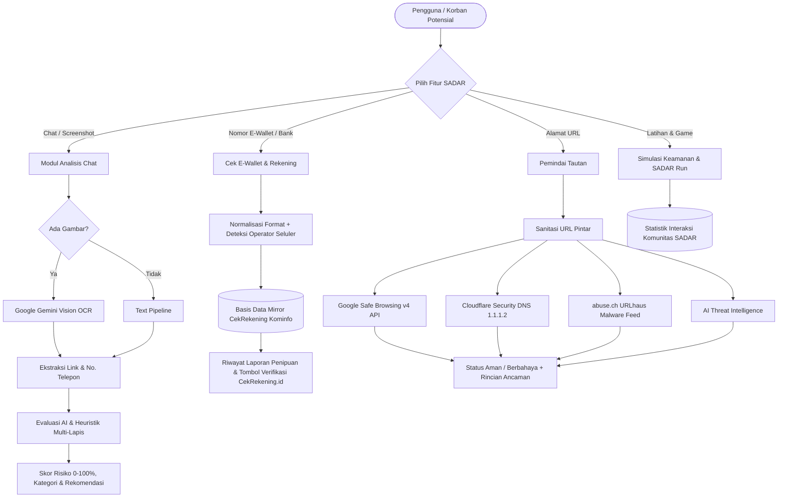

<p align="center">
  
</p>

<h1 align="center">🛡️ SADAR (Sistem Analisis Data & Antisipasi Risiko)</h1>

<p align="center">
  <b>Platform Edukasi & Deteksi Dini Keamanan Siber Terintegrasi AI Vision & Threat Intelligence</b><br/>
  Karya Mahasiswa Universitas Indonesia untuk Ruang Digital Indonesia yang Aman & Sadar Risiko
</p>

<p align="center">
  
  
  
  
  
  
  
</p>

---

## 👥 Profil Pengembang & Tim

Website ini dirancang, dibangun, dan dikembangkan oleh tim independen mahasiswa **Universitas Indonesia**:

* **Institusi:** Universitas Indonesia (UI)
* **Divisi / Tim Proyek:** Tim Riset & Rekayasa Keamanan Siber SADAR (*SADAR Cyber Defense Team*)
* **Kolaborator Utama:**
  1. **Pengembang 1 (Lead Full-Stack & AI Architecture):** Bertanggung jawab atas integrasi AI Vision OCR, orkestrasi multi-engine Safe Browsing, perancangan arsitektur server Next.js & Express, serta logika heuristik penipuan.
  2. **Pengembang 2 (Lead UI/UX & Interactive Engineering):** Bertanggung jawab atas desain sistem visual 3D glassmorphic, interaktivitas Framer Motion, minigame edukatif SADAR Run, dan jembatan verifikasi CekRekening Kominfo.

---

## 💡 Tentang Platform SADAR

Di era digital saat ini, masyarakat Indonesia kerap menjadi korban kejahatan siber berbasis manipulasi psikologis (*social engineering*), seperti **pencurian kode OTP perbankan**, pengiriman **file malware kurir paket `.apk`**, penyebaran **tautan phishing tiruan**, serta transaksi fiktif melalui **akun dompet digital (E-Wallet)** prabayar.

**SADAR (Sistem Analisis Data & Antisipasi Risiko)** hadir sebagai ruang aman terpadu bagi masyarakat awam maupun institusi untuk:
1. **Memeriksa keaslian chat dan tangkapan layar (screenshot)** secara otomatis sebelum menuruti instruksi pelaku.
2. **Membedah tautan asing (URL)** secara *zero-click* (tanpa membukanya di browser pengguna).
3. **Memeriksa rekam jejak nomor E-Wallet & Rekening Bank** melalui sistem mirror basis data penipuan Kominfo sebelum melakukan transfer uang.
4. **Mengasah naluri keamanan** melalui simulasi interaktif skenario nyata dan minigame edukasi.

---

## 🚀 Fitur Unggulan

| No | Fitur | Keterangan & Cara Kerja |
|---|---|---|
| **1** | **Deteksi Chat & Screenshot AI Vision** | Menganalisis pesan teks WhatsApp/Telegram/SMS serta mengekstrak teks gambar screenshot menggunakan **Google Gemini 3 Flash Vision OCR** & OpenAI gpt-4o-mini untuk mendeteksi desakan waktu, ancaman blokir, phishing, dan malware `.apk`. |
| **2** | **Cek E-Wallet & Rekening (Mirror Kominfo)** | Pengecekan nomor akun **DANA, GoPay, OVO, ShopeePay, LinkAja, & Rekening Bank** (BCA, BRI, Mandiri, dll.) terhadap riwayat laporan penipuan CekRekening.id (Kemkomdigi), dilengkapi identifikasi operator seluler otomatis dan formulir pelaporan masyarakat. |
| **3** | **Pemindai Link Multi-Engine (Safe Browsing)** | Memindai URL secara *real-time* menggabungkan 4 lapisan pengujian: **Google Safe Browsing v4**, **Cloudflare 1.1.1.2 Security DNS**, **URLhaus Abuse.ch Threat Feed**, dan **AI Threat Intelligence**. |
| **4** | **Simulasi Keputusan Skenario Nyata** | Pusat simulasi interaktif (*interactive scenario learning*) dengan 4 skenario modus kejahatan siber kontemporer (Kurir APK, Call Center Palsu, Quishing, Typosquatting) beserta panduan pemulihan darurat. |
| **5** | **SADAR Run (Minigame Edukatif)** | Permainan browser 2D berbasis HTML5 Canvas untuk melatih refleks reflek visual menghindari jebakan malware sambil mengumpulkan perisai autentikasi 2FA. |
| **6** | **Telemetry & Indikator Jaringan Real-Time** | Indikator status pasif konektivitas jaringan (Online / Offline) serta pencatat statistik interaksi kumulatif komunitas yang tersimpan aman secara persisten di *Local Storage*. |

---

## 🔄 Alur Kerja Sistem (System Workflow)



---

## 🛠️ Tech Stack & Ekosistem Teknologi

### 🌐 Frontend
- **Framework Utama:** [Next.js](https://nextjs.org/) (App Router, React 19)
- **Bahasa Pemrograman:** [TypeScript 5.7](https://www.typescriptlang.org/)
- **Styling & Desain:** [Tailwind CSS 3.4](https://tailwindcss.com/) dengan visual 3D Glassmorphism & CyberMesh Canvas
- **Animasi & Interaktivitas:** [Framer Motion 11](https://www.framer.com/motion/)
- **Ikonografi:** [Lucide React](https://lucide.dev/)

### ⚙️ Backend & API Service
- **Server:** Node.js (v20+ / v22 LTS) dengan runtime ganda (Next.js Route Handlers + Standalone Express Service)
- **Pemrosesan File:** `multer` (in-memory buffer parsing untuk screenshot)
- **Server Production Entrypoint:** `server.js` (siap pakai untuk hosting cPanel / Passenger / VPS / Docker)

### 🤖 Kecerdasan Buatan & Threat Feeds
- **Google Gemini API:** `gemini-3-flash-preview` (Vision OCR & Analisis Modus Kejahatan)
- **Google Safe Browsing API:** v4 ThreatMatches API
- **Cloudflare DNS:** 1.1.1.2 Security DNS-over-HTTPS
- **abuse.ch URLhaus:** Global Malware URL Sharing API
- **OpenAI API:** `gpt-4o-mini` (Model cadangan)
- **Groq Cloud:** `llama-3.3-70b-versatile` (Model cadangan)

---

## ⚡ Panduan Instalasi Lokal (Quick Start)

### 1. Prasyarat Sistem
* [Node.js](https://nodejs.org/) versi 20.9.0 atau yang lebih baru
* npm atau yarn / pnpm

### 2. Kloning Repositori & Pasang Dependensi
```bash
git clone https://github.com/username-anda/sadar-cyber-education.git
cd sadar-cyber-education
npm install
```

### 3. Konfigurasi Environment (`.env`)
Salin file `.env.example` menjadi `.env`:
```bash
cp .env.example .env
```
Isi variabel konfigurasi utama (kunci API Anda):
```env
PORT=3000
WEB_ORIGIN=http://localhost:3000

# API Kunci Gemini AI (Vision OCR)
GEMINI_API_KEY=AIzaSy...
GEMINI_MODEL=gemini-3-flash-preview

# API Google Safe Browsing
GOOGLE_SAFE_BROWSING_API_KEY=AIzaSy...
```

### 4. Menjalankan Server Pengembangan
```bash
npm run dev
```
Buka browser pada alamat `http://localhost:3000`.

---

## 📦 Panduan Build & Deploy ke Hosting (cPanel / Arenhost)

Aplikasi telah dilengkapi file startup produksi `server.js` yang menggabungkan seluruh fungsionalitas Next.js dan API backend dalam satu proses terpadu.

1. **Build Produksi di Komputer Lokal:**
   ```bash
   npm run build
   ```
2. **Arsipkan ke ZIP:**
   Kompres folder `.next/`, `app/`, `components/`, `lib/`, `public/`, `server/`, serta file `server.js`, `package.json`, dan file konfigurasi lainnya (tanpa `node_modules`).
3. **Upload ke cPanel Arenhost:**
   Unggah dan ekstrak file ZIP ke direktori aplikasi (misal: `/home/username/sadar-app`).
4. **Buka Menu "Setup Node.js App" di cPanel:**
   * **Node.js Version:** Pilih 20.x atau 22.x
   * **Application Mode:** `Production`
   * **Application Root:** `sadar-app`
   * **Application Startup File:** `server.js`
   * Masukkan variabel `GEMINI_API_KEY` dan `GOOGLE_SAFE_BROWSING_API_KEY` pada kolom *Environment Variables*.
5. Klik **Create**, lalu klik **Run NPM Install** dan **Restart**.

*(Panduan deployment langkah demi langkah yang lebih detail tersedia pada dokumen [PANDUAN_SETUP_DAN_DEPLOY_ARENHOST.md](PANDUAN_SETUP_DAN_DEPLOY_ARENHOST.md))*

---

## ⚖️ Lisensi & Penafian (Disclaimer)

* **Hak Cipta:** Dikembangkan untuk tujuan edukasi dan perlindungan keamanan digital masyarakat Indonesia.
* **Penafian:** Platform SADAR memberikan analisis bantuan berbasis kecerdasan buatan dan basis data pihak ketiga terpercaya. Hasil pemeriksaan bersifat mitigasi risiko dan edukatif, serta tidak menggantikan proses verifikasi atau hukum resmi dari pihak kepolisian maupun regulator perbankan.
