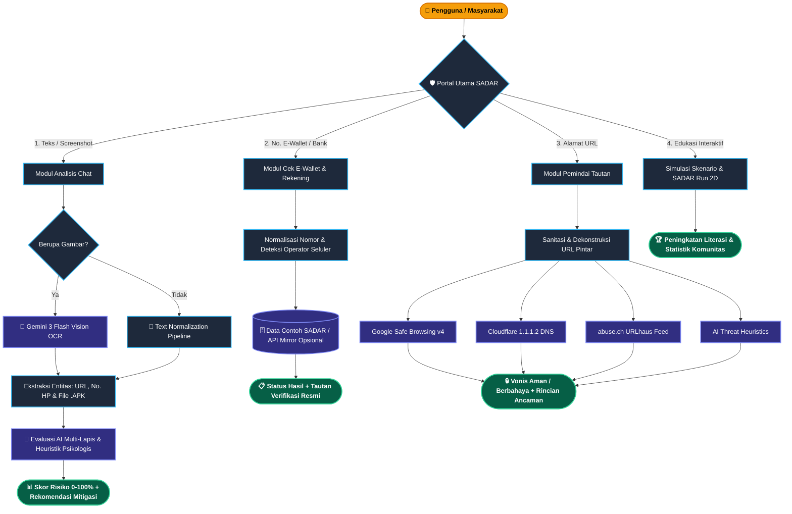

<div align="center">

  <!-- Logo Utama & Makara UI -->
  <a href="https://sadar-seven.vercel.app" target="_blank">
    
  </a>

  # 
  ### **Sistem Analisis Data & Antisipasi Risiko**
  
  *Platform Edukasi & Deteksi Dini Keamanan Siber Terintegrasi AI Vision & Threat Intelligence*

  <p align="center">
    
    &nbsp;<b>Karya Tim "Apa Aja Lah" — Universitas Indonesia</b><br/>
    <i>Mewujudkan Ruang Digital Indonesia yang Tangguh, Aman, dan Sadar Risiko</i>
  </p>

  <!-- Tombol Aksi Cepat / Live Demo -->
  <p align="center">
    <a href="https://ristek.link/sadar" target="_blank">
      
    </a>
    <a href="#-arsitektur--alur-kerja-sistem">
      
    </a>
  </p>

  <!-- Lencana Tech Stack -->
  <p align="center">
    
    
    
    
    
    
    
  </p>

</div>

---

## 📌 Daftar Isi

- [👥 Profil Tim Pengembang (`Apa Aja Lah`)](#-profil-tim-pengembang)
- [💡 Latar Belakang & Solusi SADAR](#-latar-belakang--solusi-sadar)
- [🚀 Fitur Utama](#-fitur-utama)
- [🔄 Arsitektur & Alur Kerja Sistem](#-arsitektur--alur-kerja-sistem)
- [🛠️ Teknologi](#-teknologi) 
- [⚡ Menjalankan SADAR di Lokal](#-menjalankan-sadar-di-lokal)
- [🏦 Catatan Integrasi Data Cek Rekening](#-catatan-integrasi-data-cek-rekening)
- [⚖️ Catatan Penggunaan](#-catatan-penggunaan)

---

## 👥 Profil Tim Pengembang

Platform **SADAR** dirancang, direkayasa, dan dikembangkan oleh tim mahasiswa **Universitas Indonesia** dalam misi melindungi masyarakat dari ancaman rekayasa sosial (*social engineering*) dan kejahatan siber modern.

<div align="center">

|  | **Tim Pengembang:** `Apa Aja Lah`<br/>**Institusi:** Universitas Indonesia (UI)<br/>**Fokus Riset:** *AI-Driven Cyber Defense, Threat Intelligence & Public Digital Literacy* |
| :---: | :--- |

</div>

### 🧑‍💻 Anggota Tim & Pembagian Peran

| Peran & Tanggung Jawab | Profil Pengembang | Fokus Rekayasa & Kontribusi Utama |
| :--- | :--- | :--- |
| **Team Leader**<br/>*Lead Full-Stack & AI Architecture* | **Ario Zulkaisi Nubli**<br/>*(Universitas Indonesia)* | • Orkestrasi **Google Gemini Vision OCR** & pipeline LLM fallback<br/>• Integrasi multi-engine **Safe Browsing v4**, Cloudflare DNS & URLhaus<br/>• Perancangan arsitektur **Next.js App Router**, server kustom & heuristik penipuan, & DevOps |
| **Asisten Desain UI/UX** | **Aisyah Azka Salsabila**<br/>*(Universitas Indonesia)* | • Membantu perancangan desain visual |

---

## 💡 Latar Belakang & Solusi SADAR

Di tengah pesatnya transformasi digital di Indonesia, masyarakat menghadapi berbagai modus kejahatan siber berbasis manipulasi psikologis (*social engineering*), seperti:
- 🚨 **Pencurian kode OTP perbankan** dengan taktik intimidasi atau darurat palsu.
- 📦 **Penyebaran malware `.apk`** berkedok resi kurir paket, undangan pernikahan, atau surat tilang.
- 🔗 **Tautan *phishing* & *typosquatting*** yang meniru situs institusi resmi.
- 💸 **Penipuan transaksi fiktif** melalui nomor E-Wallet prabayar dan rekening penampung.

**SADAR (Sistem Analisis Data & Antisipasi Risiko)** hadir sebagai garda pertahanan pertama yang dapat diakses langsung di:
👉 **[https://ristek.link/sadar](https://ristek.link/sadar)**

Melalui pendekatan **Zero-Click Threat Analysis** dan **AI Vision**, SADAR memberdayakan pengguna untuk:
1. **Mendeteksi manipulasi chat & tangkapan layar (screenshot)** secara otomatis sebelum terperdaya instruksi pelaku.
2. **Membedah tautan mencurigakan (URL)** di ruang isolasi tanpa harus membukanya di perangkat sendiri.
3. **Memeriksa indikasi laporan nomor E-Wallet & Rekening Bank** melalui data contoh/mirror, lalu memverifikasi hasilnya melalui kanal resmi sebelum bertransaksi.
4. **Melatih reflek keamanan siber** lewat simulasi keputusan dunia nyata dan *arcade minigame* interaktif.

---

## 🚀 Fitur Utama

| Modul | Fitur Utama | Cara Kerja & Kapabilitas Teknis |
| :---: | :--- | :--- |
| 🧠 **01** | **Analisis Chat & Screenshot dengan AI** | Menganalisis teks dan gambar dengan provider AI yang dikonfigurasi, seperti Gemini, OpenAI, atau Groq (tergantung dukungan endpoint dan konfigurasi). |
| 🏦 **02** | **Cek E-Wallet & Rekening** | Memeriksa nomor terhadap data contoh/mirror lokal SADAR dan, bila dikonfigurasi, API eksternal. Tersedia tautan untuk verifikasi dan pelaporan melalui kanal resmi. |
| 🛡️ **03** | **Multi-Engine Link Scanner (Zero-Click)** | Memindai URL secara *real-time* melalui 4 lapisan pertahanan simultan: **Google Safe Browsing v4**, **Cloudflare 1.1.1.2 Malware DNS**, **abuse.ch URLhaus Threat Feed**, dan **AI Threat Intelligence**. |
| 🎯 **04** | **Interactive Scenario Decision Lab** | Laboratorium simulasi interaktif dengan 4 skenario kejahatan siber paling marak (*Kurir APK, Call Center Palsu, QRIS Quishing, Typosquatting*) lengkap dengan panduan mitigasi dan pemulihan darurat (*Incident Response*). |
| 🎮 **05** | **SADAR Run (Cyber Arcade Minigame)** | Permainan web 2D berbasis **HTML5 Canvas** yang melatih ketangkasan kognitif dan visual pengguna dalam menghindari jebakan *trojan/phishing* sembari mengumpulkan perisai autentikasi dua faktor (**2FA**). |
| 📡 **06** | **Status Koneksi & Preferensi Lokal** | Menampilkan status koneksi dan menyimpan sebagian preferensi atau statistik penggunaan di browser. |

---

## 🔄 Arsitektur & Alur Kerja Sistem

Diagram berikut memvisualisasikan bagaimana setiap modul di dalam **SADAR** memproses data secara paralel dan menghasilkan vonis risiko dalam hitungan detik:



## 🛠️ Teknologi

- **Aplikasi web:** 
    
    
    
    
- **API & Integrasi:** 
     [](https://1.1.1.1/family/)

## ⚡ Menjalankan SADAR di Lokal

### Prasyarat

- [Git](https://git-scm.com/downloads)
- [Node.js](https://nodejs.org/) versi **20.9 atau lebih baru** (npm disertakan bersama Node.js)

### Clone dan instal dependency

Jalankan perintah berikut di terminal:

```bash
git clone https://github.com/Rio3zN9G/Sistem-Analisis-Data-Antisipasi-Risiko.git
cd Sistem-Analisis-Data-Antisipasi-Risiko
npm install
```

### Konfigurasi API (opsional)

Aplikasi dapat dijalankan tanpa API key, tetapi fitur yang bergantung pada layanan eksternal mungkin tidak aktif. Untuk mengaktifkannya, buat file `.env` di folder utama proyek dan isi hanya dengan key yang Anda miliki:

```env
GEMINI_API_KEY=
GEMINI_MODEL=gemini-3-flash-preview
OPENAI_API_KEY=
GROQ_API_KEY=
GOOGLE_SAFE_BROWSING_API_KEY=
CEKREKENING_API_URL=
CEKREKENING_API_KEY=
```

Simpan key rahasia hanya di `.env` lokal atau pengaturan environment hosting. Jangan menaruh key di source code, mengirimkannya lewat chat, atau menggunakan prefix `NEXT_PUBLIC_` untuk key rahasia. Jangan commit file `.env`.

### Jalankan aplikasi

```bash
npm run dev
```

Perintah tersebut menjalankan Next.js dan API Express secara bersamaan. Buka **http://localhost:3000** untuk aplikasi. API Express berjalan pada **http://localhost:4000**; endpoint pemeriksaan kesehatannya adalah **http://localhost:4000/api/health**.

Untuk menghentikan server, tekan `Ctrl+C` di terminal. Jika ingin membuat build produksi lokal, jalankan `npm run build`; perintah `npm start` menjalankan server produksi setelah build selesai.

## 🏦 Catatan Integrasi Data Cek Rekening

Fitur cek rekening SADAR **bukan koneksi langsung ke database internal atau API resmi Komdigi**. Dalam konfigurasi bawaan, aplikasi menggunakan sejumlah record contoh untuk pengembangan dan laporan yang dikirim pengguna selama proses aplikasi berjalan. Record contoh bukan laporan resmi yang telah diverifikasi; ganti atau hapus sebelum penggunaan publik. Data laporan runtime disimpan di memori, sehingga tidak dijamin tetap ada setelah server dimulai ulang.

Integrasi ke sumber eksternal hanya dilakukan jika pemilik proyek mengisi `CEKREKENING_API_URL` dan, bila diwajibkan oleh penyedia, `CEKREKENING_API_KEY` dengan endpoint yang memang berhak digunakan. Endpoint tersebut menerima jenis akun, penyedia, dan nomor akun yang sudah dinormalisasi. Label sumber internal SADAR atau kata “mirror” tidak membuktikan bahwa data berasal dari Komdigi. Pastikan ada izin, dasar penggunaan, perlindungan data, dan format API yang sesuai sebelum menghubungkan layanan apa pun; jangan menganggap data contoh atau hasil mirror sebagai data resmi Komdigi.

Gunakan hasil SADAR sebagai **indikasi awal**, bukan bukti bahwa seseorang melakukan penipuan. Status “belum dilaporkan” juga tidak menjamin akun aman. Verifikasi mandiri melalui [CekRekening.id](https://cekrekening.id/periksa-rekening), dan gunakan [AduanNomor.id](https://aduannomor.id) untuk kanal pelaporan nomor telepon. Jangan mengirim uang, OTP, PIN, atau kata sandi hanya berdasarkan hasil pengecekan.

## ⚖️ Catatan Penggunaan

- Hasil analisis otomatis dapat keliru atau tidak lengkap; lakukan verifikasi tambahan sebelum mengambil keputusan.
- Jangan mengunggah data pribadi, bukti transaksi, atau tangkapan layar sensitif kecuali diperlukan dan Anda memahami layanan pihak ketiga yang digunakan.
- API key dan layanan pihak ketiga dapat memiliki biaya, batas kuota, serta ketentuan penggunaan masing-masing.
- Repository ini tidak menyatakan afiliasi atau dukungan resmi dari Komdigi maupun penyedia layanan eksternal yang disebutkan.
